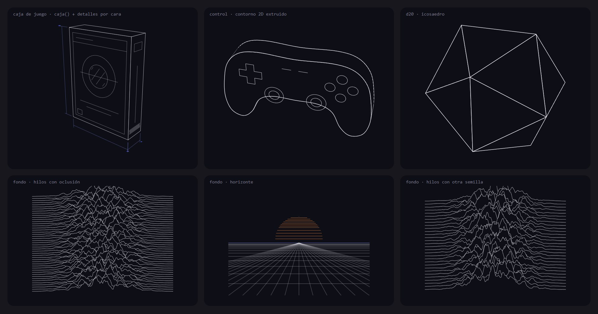
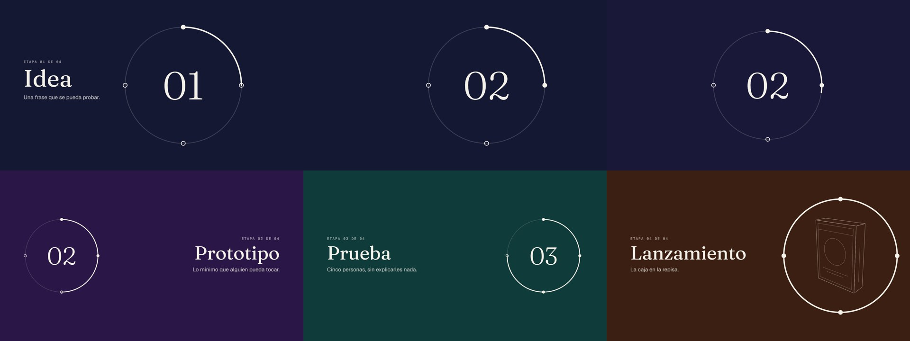

# Propuesta: dibujo a líneas y continuidad entre láminas

> Estado: **implementado** el 16/oct/2026 (ver «Lo que cambió al implementarlo»
> al final): la receta `continua`, el motor `kit.lineas` con la receta `traza` y
> los fondos `hilos`, `horizonte` y `guilloche`. Pendiente: objetos que giren
> entre láminas y el deck de prueba. Las imágenes de esta carpeta son de los
> prototipos de la investigación.
> Responde a dos pedidos de Axl: que los SVG ilustrativos se **generen** —objetos
> como la caja de un juego y fondos decorativos, minimalistas y hechos de líneas—
> en vez de usar ilustraciones de stock, y qué estilos de presentación nos abre
> la web, empezando por el del «objeto que se queda mientras cambia el fondo».

## Resumen

1. **Dibujo a líneas**: un motor propio (`kit.lineas`) que proyecta objetos 3D
   sencillos y los pinta solo con trazos, quitando lo que queda detrás. El
   prototipo (~200 líneas) ya saca la caja del juego con cotas de plano, un
   control, un dado y fondos de hilos o de horizonte, en build-time,
   deterministas y animables con la receta `dibujo` que ya existe. De las
   librerías, la única que vale la pena tener a mano es **heerich**, para
   escenas de cajas. **Recomendado: motor propio.**
2. **Continuidad**: la técnica se llama **Morph** en PowerPoint y **Magic
   Move** en Keynote; como concepto, *transición de elemento compartido* o
   *constancia de objeto*. Cabe en el kit como una receta más (`continua`):
   el mismo elemento marcado en láminas seguidas se lleva de su sitio anterior
   al nuevo, con el fondo fundiéndose detrás. **Recomendado**, y en el video
   sale sin costura.
3. `kit.ilustracion` (Open Doodles) **se queda en el kit pero deja de
   recomendarse**: no encaja con la línea visual.
4. **Nada de esto va solo.** La continuidad no es «el círculo»: puede viajar
   cualquier cosa (una imagen, una cifra, una palabra, una forma, una gráfica,
   un dibujo a líneas, la cámara misma), y lo que la hace lucir es combinarla
   con lo que ya existe —quemado, tinta, contorno, cámara, cometa, sello,
   contador, patrones, transiciones del video—. La sección 3 dice cómo se suman
   y qué le tocaría a cada serie.

## 1. Dibujo a líneas generado

### El prototipo

Un motor de ~200 líneas, sin dependencias, que corre en el `gen.js`:

- **Caja de juego**: `caja()` de 150 × 200 × 44, con detalles pegados a cada
  cara (marco, franja, el círculo del arte con achurado, renglones de título,
  el lomo) y **cotas de plano** en el color de acento. 7 KB, 45 trazos.
- **Control**: un contorno 2D suavizado y **extruido**; los botones, la cruceta
  y los sticks son detalles de la tapa. 22 KB, 163 trazos.
- **Dado de 20**: un icosaedro. 1 KB.
- **Fondos**: `hilos` (líneas de cresta que se tapan entre sí, el estilo de la
  portada de *Unknown Pleasures*; 90–136 KB, ~20 KB comprimido) y `horizonte`
  (rejilla en perspectiva con un sol de franjas; 6 KB).

Cómo dibuja: proyecta, descarta las caras de espaldas y pinta las demás de
atrás hacia adelante **rellenas del color del fondo**, así las cercanas tapan
las líneas de las lejanas (el algoritmo del pintor). Es determinista y se anima
tal cual con la receta `dibujo`.

Lo que enseñó y que la versión del kit debe corregir:

- **El relleno del color del fondo solo funciona sobre fondo liso.** Sobre una
  foto o un degradado se verían las caras. La versión buena quita las líneas
  ocultas de verdad: corta cada arista donde la cruza otra y prueba el punto
  medio de cada tramo (lo que hacen *ln* y three-plotter-renderer). Así salen
  trazos puros que van sobre cualquier fondo y que DrawSVG anima mejor.
- En el control, la silueta del lado curvo sale **punteada** donde las facetas
  alternan entre visibles y ocultas. Se resuelve dibujando solo siluetas,
  pliegues (arista entre caras con más de ~30° de diferencia) y bordes, nunca
  las costuras de las facetas.

### Lo que hay afuera

| Opción | Licencia / estado | ¿Corre en Node? | Veredicto |
|---|---|---|---|
| **heerich** (meodai) | MIT, activo | Sí, sin DOM ni `Math.random` | Escenas de **vóxeles** con oclusión real, rayado por cara y calcas; `toSVG()` da el string. **El mejor de afuera para cosas de cajas** (la caja del juego, una consola); las curvas salen escalonadas |
| **@lnjs/core** (port de *ln*, de Fogleman) | ISC, abandonado desde 2020 | Sí | Esfera, cilindro, cono, CSG, con líneas ocultas por rayos. Las mallas salen en alambre (todas las aristas de los triángulos) |
| **three-plotter-renderer** | MIT, activo | No (WebGL) | Siluetas, sombreado y líneas ocultas sobre cualquier modelo de three.js. Usable con el Chrome del repo, como `kit.diagrama`, si un día hacen falta modelos OBJ/GLTF |
| **Zdog** | MIT, quieto desde 2022 | Con un shim de DOM | Estética redonda y gruesa, **sin** líneas ocultas: no es el look |
| **Rough.js** | MIT | Sí | Estilo boceto, lo contrario de elegante; lo útil es su **hachure-fill** (rellenar un polígono con paralelas), 60 líneas portables |
| **isometric, Isomer, obelisk** | MIT/Apache | jsdom o canvas | Planos 2D o píxeles; sin líneas ocultas |
| **fffuel, Haikei, Pattern Monster** | Web | Sin API (Pattern Monster: API con clave) | Fondos bonitos pero a mano; **fffuel prohíbe redistribuir**, y el repo es público |

### Qué hace que se vea elegante (y qué lo abarata)

- **Qué aristas**: siluetas, pliegues y bordes. Ver la triangulación es lo que
  más abarata.
- **Dos grosores como máximo**: contorno ~1,5–2× y detalle 1×; el achurado,
  más fino. Puntas y uniones redondas, y `vector-effect: non-scaling-stroke`
  si se escala.
- **Proyección isométrica, o perspectiva con un campo de visión estrecho**
  (~20–28°); el gran angular deforma.
- **Sombrear con paralelas** de separación constante: las caras iluminadas
  vacías, 2–3 tonos como mucho. Separación ≥ 6 px a 1080 de ancho, o el
  achurado hace moiré al comprimir el video.
- **Cotas y anotaciones finas** en el color de acento: es lo que lo vuelve
  «plano técnico» en vez de «ícono».
- **Orden de los trazos** para animar: silueta → pliegues → detalles →
  achurado, con los tramos colineales unidos; así se ve una sola pluma.

### Cómo entraría al kit

1. **`tools/kit-lineas.cjs` propio** (recomendado), unas 300 líneas:
   constructores (caja con chaflán, extrusión de contorno, revolución de un
   perfil para trofeos y copas, cilindro, poliedros), cámara isométrica u
   ortográfica con perspectiva suave, aristas por silueta/pliegue, líneas
   ocultas por corte + rayo, achurado por cara, cotas, y salida agrupada y
   ordenada para `dibujo`. Caché en `tools/cache/lineas/` como `kit.contorno`.
   Por qué propio: ninguna librería deja controlar el orden y el agrupado de los
   trazos, que es lo que decide cómo se ve la animación.
2. **heerich vendorizado en `tools/vendor/`**, solo en build, como atajo para
   escenas de cajas (sin verificar: que pueda pintar solo trazo sin la rejilla
   de vóxeles).
3. **Fondos**: nuevos tipos de `kit.patron` en vez de una librería —`hilos`
   (crestas con horizonte flotante), `horizonte`, `guilloche` (las rosetas de
   los billetes), `rayado` e `iso`— y distancia mínima entre curvas para el
   `flujo` que ya existe.

## 2. El objeto que se queda: continuidad entre láminas

### Cómo se llama

No tiene un nombre único; cada herramienta lo bautiza:

| Herramienta | Nombre | Cómo empareja |
|---|---|---|
| PowerPoint | **Morph** (Transformación) | Mismo objeto en láminas seguidas; con el prefijo `!!` en el nombre se fuerza la pareja |
| Keynote | **Magic Move** | Duplicar la lámina y mover el objeto; lo que no tiene pareja entra o sale fundido |
| Figma | **Smart Animate** | Nombre de capa y jerarquía |
| reveal.js | **Auto-Animate** | `data-id`, o texto/`src` idénticos |
| Navegador | **View Transitions API** | `view-transition-name` |

Como principio de diseño es la **constancia de objeto** (*object constancy*,
Mike Bostock): el espectador sigue al mismo objeto a través del cambio. Para
buscar ejemplos, «Morph» o «Magic Move» es lo que da resultados.

Parientes cercanos: el **gráfico sticky del scrollytelling** (The Pudding, NYT:
un gráfico fijo mientras avanzan los pasos), el **container transform** de
Material (un contenedor que se vuelve otro, p. ej. el círculo que crece hasta
ser el fondo) y el **lienzo con cámara** de Prezi/impress.js, que es lo inverso:
se mueve la cámara, no el objeto (nuestra receta `camara`).

### El prototipo

Cuatro etapas («Idea → Prototipo → Prueba → Lanzamiento»). Un anillo marca el
avance: cambia de tamaño y de lugar, su arco crece y el fondo vira de color; en
la última etapa enmarca la caja del juego, que se dibuja a líneas. Arriba a la
izquierda, el final de la lámina 1; al lado, **el primer cuadro de la 2, que es
idéntico**: por eso en el video el anillo viaja sin corte.

### Cómo entra al kit

Una receta `continua` en `kit.efectos()`:

- **Marcado**: `data-continua="anillo"` en el mismo elemento de láminas
  seguidas. Cada lámina sigue completa por sí sola (PDF, miniaturas, portadas,
  `kit.diferir` siguen funcionando); no es una capa global encima del deck.
- **Pareja**: la lámina anterior **en el orden del deck**, no la última que se
  vio, para que `cuadros.mjs` (que renderiza cada lámina desde t=0) dé lo mismo
  que la navegación. Si se llega retrocediendo, la pareja es la siguiente.
- **Medida**: `offsetLeft`/`offsetTop` acumulados hasta la `<section>`, como
  `crece` y `reordena`; nada de Flip ni `getBoundingClientRect`, que no ven la
  escala de deck-stage. La lámina anterior se puede medir aunque esté oculta:
  `visibility: hidden` conserva el layout.
- **Qué viaja**: posición y tamaño (FLIP), el fondo de la sección
  (`backgroundColor` desde el de la anterior) y lo que la receta sepa
  interpolar dentro del objeto: el arco de avance (`stroke-dashoffset`), un
  contador, un color.
- **Video**: la lámina emparejada va con `"transicion": "corte"` en el guion;
  un xfade encima enseñaría el objeto dos veces.

Cuidados que salieron en el prototipo y en la investigación:

- Al escalar el objeto se escalan sus trazos: el anillo engorda a mitad de
  camino. Los trazos van con `vector-effect: non-scaling-stroke`.
- El número de adentro cambia de golpe («01» → «02»); mejor contarlo o
  fundirlo entre dos copias. Con texto, nunca escalas distintas en X y en Y.
- Una imagen diferida sin cargar mide 0: lo emparejado lleva tamaño explícito.
- Si la timeline de la lámina anterior deja un transform en el objeto, hay que
  sumarlo al medir.
- El objeto emparejado vive en el paso 0 (sin `data-step`).
- **View Transitions no sirve aquí**: captura el estado viejo como imagen fija,
  no vive en la timeline de GSAP y no se puede seekear para el video.

## 3. Cómo se suman los recursos

El prototipo usa un anillo porque es lo más fácil de leer, pero la receta no
sabe nada de círculos: empareja **cualquier elemento** por nombre y decide qué
interpolar según lo que encuentre. Seis modos, todos medibles y seekeables:

| Modo | Qué viaja | Se arma con |
|---|---|---|
| **mueve** | Posición y tamaño de lo que sea: una carta, una foto, un emblema, un número, la caja del juego | FLIP (el prototipo) |
| **cuenta** | Una cifra arranca en el valor de la lámina anterior y llega al suyo: 30 ⇒ 35 en un parche, el elo de una temporada a otra | `contador` con el inicio leído de la pareja |
| **transforma** | Una forma se vuelve otra: el círculo se hace cuadro, el contorno de un mapa se vuelve una región, una barra se vuelve un punto de la línea | `transforma` (MorphSVG) con el `desde` en la lámina anterior |
| **crece** | Una celda o un marco chico de la lámina anterior se vuelve el fondo a sangre de esta (el *container transform* de Material) | FLIP + `clip-path`, y al llegar, `empuje` o `camara` |
| **sigue** | Una línea que se empezó a dibujar sigue desde donde se quedó: un recorrido, una cronología, la gráfica que suma un punto por lámina | `cometa` / `linea` arrancando en el avance de la pareja |
| **cámara** | No se mueve el objeto sino la vista: un lienzo grande (un mapa, la caja del juego a líneas) y cada lámina es un encuadre | `camara` con el foco inicial tomado de la lámina anterior |

Y alrededor del objeto que viaja, lo que ya tenemos hace el resto:

- **Cuando el objeto cambia de identidad** (otra skin, otro campeón, otra
  semana): el marco se queda y lo de adentro se reemplaza con `quemado`,
  `tinta` o `glitch`. El marco da la continuidad; el efecto, el cambio.
- **Cuando el objeto llega**: `contorno` (el arte entra primero como dibujo de
  sí mismo), `dibujo` para las piezas a líneas, `sello` para el veredicto de
  la etapa, `marcatextos` sobre el dato.
- **Detrás**: el fondo funde su color, y un patrón con la misma semilla
  (`hilos`, `curvas`, `flujo`) se desplaza un poco en cada lámina en vez de
  aparecer de nuevo, así el fondo también parece uno solo.
- **En el video**: las láminas emparejadas van con corte (la continuidad ya es
  la transición) y las demás con un `xfade` de una sola familia.
- **Un paso más con el motor de líneas**: si `kit.lineas` deja el modelo 3D en
  el HTML y no solo el dibujo, la proyección se puede hacer en cada cuadro y el
  objeto **gira entre láminas** (la caja da media vuelta y enseña el lomo). Es
  determinista igual: el ángulo sale del tiempo de la timeline.

### Qué le tocaría a cada serie

| Serie | Hilo conductor | Combinación |
|---|---|---|
| **Cumplelolero** (9:16, solo arte) | El splash en un marco | El marco chico de la portada **crece** a sangre, la **cámara** recorre cara → arma, y en las skins el marco se queda mientras cada skin entra con **tinta**; la cifra del OTP **cuenta** desde la anterior |
| **Parches** | El marco del recorte de Riot | Se queda entre campeones y adentro cambia el recorte con **quemado**; el valor **cuenta** de viejo a nuevo y el **sello** dice buff o nerf |
| **Lore** (guerras, helia) | Un mapa o una runa | Lienzo grande con **cámara** entre regiones; el arte de cada bloque entra con **contorno**; la cronología **sigue** dibujándose |
| **Reportes semanales** | La dona y la línea de la semana | La gráfica **sigue** con un punto más por lámina; las horas **cuentan** desde la semana anterior |
| **Charlas** (dra, ultracode) | El embudo o la rueda de etapas | Ya hay un embudo chico en la cabecera de dra: con **mueve** + **cuenta** marcaría el paso en vez de solo pintarlo |
| **Juegos / datos curiosos** | Un objeto a líneas (la caja, el control) | Se **dibuja** al inicio, **gira** o **mueve** entre láminas, y cada dato le cae encima con **sello** o **marcatextos** |

## 4. Estilos que la web pone fáciles

Para escoger una línea por deck o por serie. Todos funcionan con un lienzo fijo
por lámina, y casi todos tienen un candidato natural a objeto persistente:

| Estilo | Qué lo define | Su objeto persistente |
|---|---|---|
| **Suizo / tipográfico internacional** | Retícula estricta, grotesca, asimetría, alineado a la izquierda | Un módulo o filete que salta de columna en columna |
| **Editorial / revista** | Titulares serif enormes, citas destacadas, folios | El folio o el número de sección (lo que ya hace `novedades/`) |
| **Bento** | Celdas de tamaños distintos (las láminas resumen de Apple) | La celda que crece hasta ser la lámina siguiente (`crece` ya lo hace dentro de una lámina) |
| **Tipografía cinética** | El texto es el movimiento | Una palabra que se queda mientras las demás cambian |
| **Data storytelling** | Una idea por gráfica, marcas con identidad | Las barras o burbujas que viajan entre láminas (Hans Rosling) |
| **Línea / plano** | Trazos finos, cotas, monoespaciada | Una línea que se sigue dibujando de lámina en lámina |
| **Una idea por lámina** | Takahashi (texto enorme), Lessig (muchas láminas al ritmo de la voz), Presentation Zen (imagen + frase) | Es el criterio «solo visuales» de jinx: encaja con el video |
| **Neo-brutalismo** | Bordes gruesos, sombra dura, planos | Una calcomanía; vigente pero envejece rápido |
| **Vidrio / auroras** | Desenfoque y transparencia | Lo revivió Liquid Glass (2025), con críticas de legibilidad; las auroras ya son cliché SaaS. Lo único que vale la pena: **una lente circular de vidrio** como objeto persistente |

Lo que **no** conviene copiar: Pitch y Gamma no traen nada tipo Morph (solo
entradas y salidas por bloque), y Tome cerró sus presentaciones en abril de 2025.

## 5. Qué haría y en qué orden

1. **`continua`** (receta) con sus seis modos —mueve, cuenta, transforma,
   crece, sigue, cámara—, una lámina por modo en `lab/` y el prototipo de
   etapas como ejemplo. Es lo que más cambia cómo se sienten los decks y es
   pequeño: una receta y una regla en el guion del video.
2. **`kit.lineas`** con caja, extrusión, revolución, poliedros, detalles por
   cara, achurado y cotas, más los fondos `hilos` y `horizonte` como tipos de
   `kit.patron`. Después, el modelo en el HTML para que los objetos giren.
3. **Un deck de prueba que lo junte todo** —el próximo parche o un
   Cumplelolero— siguiendo la tabla de la sección 3, antes de volverlo
   criterio de serie. Y una lámina en `novedades/` que lo explique.
4. Dejar de recomendar `kit.ilustracion` en el skill `nuevo-deck`.

## Lo que cambió al implementarlo

**`continua`** (`tools/kit-efectos.cjs`), con los seis modos tal cual:

- Corre sola dentro de `efectosDeclarados` y **antes** que las demás recetas,
  para medir sin los `from()` ya aplicados. Mide con offsets de layout (los
  SVG, por su rectángulo).
- La pareja sale del orden del deck; el `slidechange` de deck-stage, que llega
  antes que la timeline, dice si se llegó retrocediendo.
- `sigue` usa `pathLength="1"` + `data-progreso` en vez de `data-avance` (que ya
  era el rectángulo de recorte de `kit.grafica`), y `kit.grafica` ganó `hasta`
  para enseñar solo los primeros puntos de la serie. `contador` ganó `desde`.
- Si un elemento emparejado declara la receta que su modo sustituye, la
  declarada no corre: así la primera lámina de la cadena entra normal.
- El video pone corte seco solo en las láminas enlazadas
  (`transiciones.enlazadas()`).
- Dos sorpresas: dos `kit.grafica` iguales compartían el id de su `clipPath`
  (ahora llevan contador), y una lámina que se llame igual que otra con
  coreografía propia hereda esa coreografía (el `data-label` es la llave).

**`kit.lineas`** (`tools/kit-lineas.cjs`, ~330 líneas):

- Líneas ocultas de verdad: corte en siluetas + prueba del punto medio contra
  todas las caras. Trazos puros: ya no hace falta un fondo liso.
- Aristas por silueta, pliegue (`umbral`, 30° por defecto) y borde: el control
  ya no sale punteado.
- Constructores: `caja`, `extruir`, `revolucion`, `cilindro`, `poliedro` (las
  caras de d4–d20 salen de la envolvente convexa) y `mover`/`rotar`/`escalar`.
- **El achurado se raya en pantalla**, no en el plano de cada cara: en el
  plano de cada faceta, las superficies curvas salían con ruido. En pantalla
  las líneas de facetas vecinas se unen y queda como un grabado.
- `traza` anima por capas: silueta, pliegues, detalles, achurado y cotas.
- Tiempos: 1–43 ms por escena; pesos de 1 a 40 KB.

**Fondos** (`kit.patron`): `hilos` usa el horizonte flotante (dibuja de
adelante hacia atrás y solo deja lo que asoma), así que ya no necesita rellenar
del color del fondo como el prototipo; `horizonte` corta las líneas de fuga en
el borde; `guilloche` quedó en 12 anillos × 300 muestras (84 KB; con 18 × 720
eran 295 KB).

**No se adoptó heerich**: el motor propio ya cubre las cajas y da el control
del orden de los trazos.

## Fuentes

- *ln*, Michael Fogleman: https://github.com/fogleman/ln · https://www.michaelfogleman.com/projects/line-art/
- @lnjs/core: https://www.npmjs.com/package/@lnjs/core
- heerich: https://github.com/meodai/heerich · https://meodai.github.io/heerich/
- three-plotter-renderer: https://github.com/neurofuzzy/three-plotter-renderer
- Zdog: https://github.com/metafizzy/zdog · Rough.js: https://github.com/rough-stuff/rough/wiki · hachure-fill: https://github.com/pshihn/hachure-fill
- isometric: https://github.com/elchininet/isometric · Isomer: https://github.com/jdan/isomer
- vpype (`linemerge`, `linesort`): https://github.com/abey79/vpype
- fffuel y su licencia: https://www.fffuel.co/license/ · Haikei: https://haikei.app/ · Pattern Monster: https://pattern.monster/
- Tyler Hobbs, campos de flujo: https://www.tylerxhobbs.com/words/flow-fields
- Ocultar líneas: https://aka-gabor.xyz/texts/webgl-line-hiding · Appel, Rohlf y Stein (1979): https://history.siggraph.org/?p=104577 · horizonte flotante: https://cgg.mff.cuni.cz/~pepca/lectures/pdf/pg1-26-horizont-en.pdf
- Microsoft, Morph: https://support.microsoft.com/en-us/office/bc7f48ff-f152-4ee8-9081-d3121788024f
- Apple, Magic Move: https://support.apple.com/guide/keynote/tanff5ae749e/mac
- Figma, Smart Animate: https://help.figma.com/hc/en-us/articles/360039818874
- reveal.js, Auto-Animate: https://revealjs.com/auto-animate/
- Mike Bostock, *Object Constancy*: https://bost.ocks.org/mike/constancy/
- Chrome, View Transitions: https://developer.chrome.com/docs/web-platform/view-transitions/same-document
- Material, sistema de movimiento: https://material.io/design/motion/the-motion-system.html
- The Pudding, scrollytelling sticky: https://pudding.cool/process/scrollytelling-sticky/
- impress.js: https://github.com/impress/impress.js
- Codrops, *Consecutive Scroll Animations with One Element* (2024): https://tympanus.net/codrops/2024/11/20/consecutive-scroll-animations-with-one-element
- Takahashi: https://en.wikipedia.org/wiki/Takahashi_method · Lessig: https://ethos3.com/designstyles-and-approachespresenting-lessig-way/
- Estilo tipográfico internacional: https://en.wikipedia.org/wiki/International_Typographic_Style
